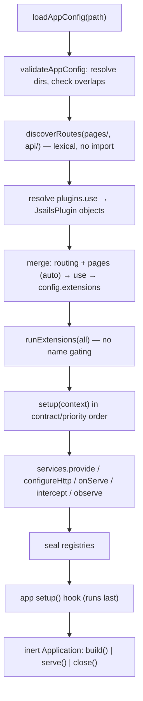
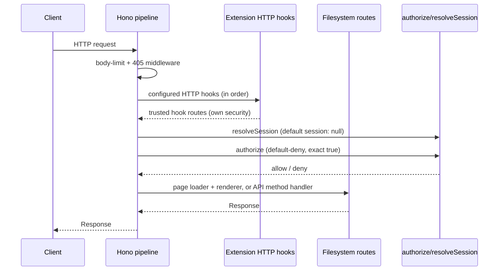
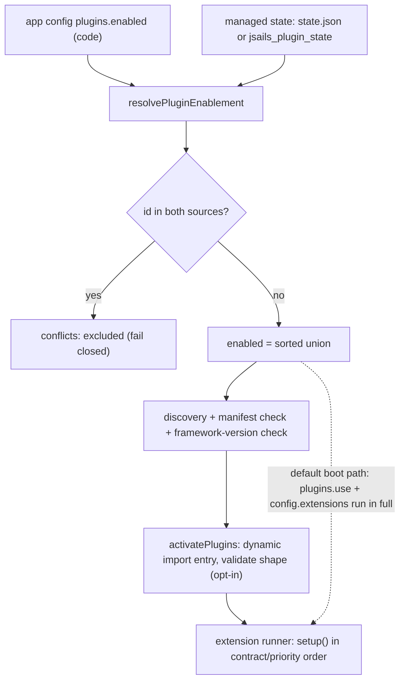
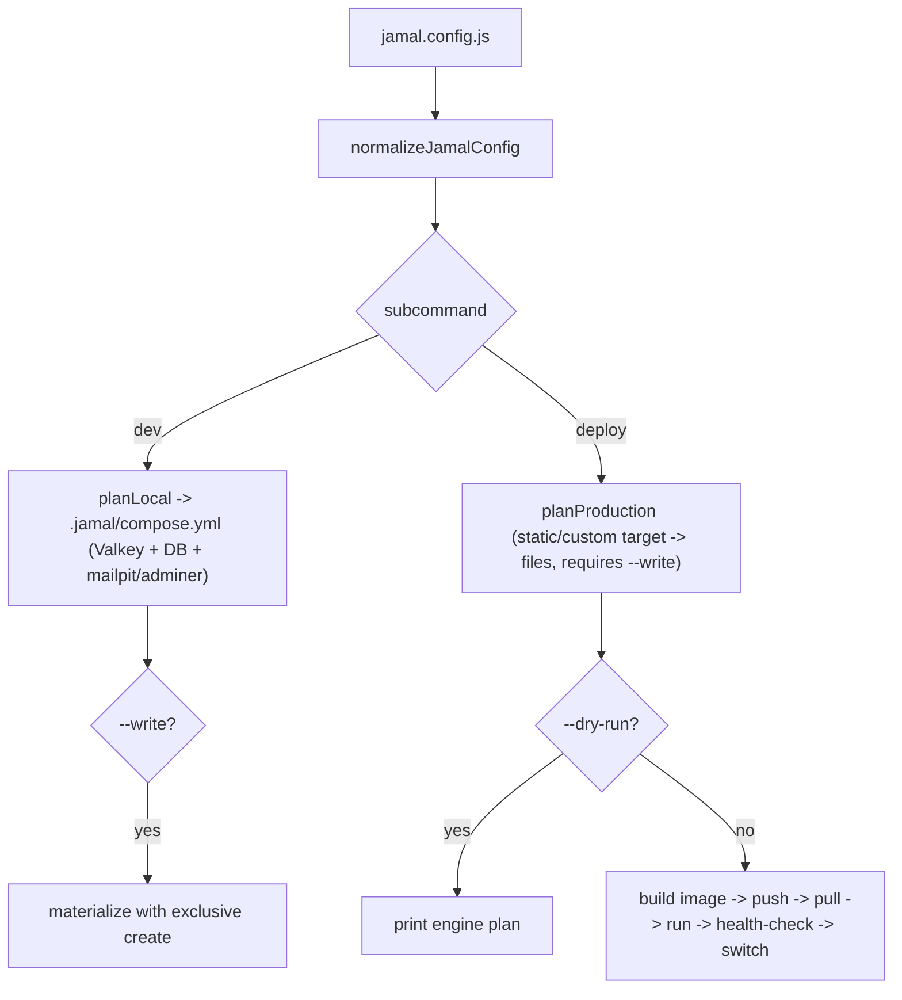

# Architecture

JSails is a TypeScript Active Record data layer plus a bounded application runtime
(extension system, HTTP/pages/API, static export, jobs, broadcast, deploy config,
and a CLI). It deliberately reuses maintained libraries — TypeORM, Zod, BullMQ,
Socket.IO, Preact, Hono — instead of implementing its own renderer, auth stack, or
queue.

## Overview and principles

- **Human-first.** The CLI scaffolds, compiles, and serves, but decisions with
  domain impact — applying migrations, destructive schema changes, running a
  production release — remain explicit human actions. `jamal deploy` and
  `jamal rollback` execute by default with `--dry-run` printing the plan.
- **Everything is a plugin.** The kernel is a thin, inert core: config loading, an
  ordered extension runner, route discovery, the Hono pipeline, and the data
  layer. Every capability — auth, admin, blog, jobs, broadcast, cache, mail,
  filesystem, notifications, server components — is a first-party plugin wired
  through the same extension seam.
- **Lazy, inert construction.** Importing a config module or calling a factory
  never opens a connection or reads the environment. Connections are opened only
  by `serve()` (or an extension's own `setup`/first use). This is what keeps
  `jsails build` (static export) working without a database.
- **MariaDB by default, but no lock-in.** Drivers: `mariadb` (recommended),
  `postgres`, `mysql`, and persistent file-backed SQLite via `sqljs`.
- **Bounded, portable schema.** The migration core models a narrow scalar schema
  and rejects anything it cannot faithfully represent.
- **Value-free errors.** Failures that cross a trust boundary never echo raw
  values, credentials, or response bodies.

## Kernel vs plugins

The **kernel** (`src/app/`, `src/extensions/`, `src/routing/`, `src/pages/`,
`src/server/`, `src/database/`, `src/migrations/`, `src/environment.ts`,
`src/contracts/`, `src/jsx/`) provides the runtime and the seams; the **plugins**
(`src/auth/`, `src/admin/`, `src/blog/`, `src/jobs/`, `src/broadcast/`,
`src/cache/`, `src/mail/`, `src/filesystem/`, `src/notifications/`,
`src/sessions/`, `src/server-components/`, `src/flags/`, `src/theme/`,
`src/plugins/`) consume them. The `src/i18n/` translator is a dependency-free leaf
(neither kernel nor plugin — it imports nothing beyond the platform).

### The extension foundation

An **extension** is a plain object `{ name, requires?, priority?, disabled?, setup(context) }`. `runExtensions` prevalidates every entry, runs `setup` in priority order (lower first, then declaration order), checks each extension's `requires` against services earlier extensions registered, collects HTTP and serve hooks, wires a per-application interceptor/observer registry, seals the registries, and returns a runtime whose `close()` runs cleanups in reverse.

The `setup` context exposes four write surfaces:

- `services.provide(token, value)` / `services.get(token)` — a per-application service registry keyed by opaque `createServiceToken<T>(name)` tokens.
- `configureHttp(hook)` — collect native Hono hooks (after body-limit/405 middleware, before filesystem routes). Hook routes own their own security.
- `onServe(hook)` — run after the HTTP server is created but before it listens.
- `intercept(operation, fn, { phase })` / `observe(event, fn)` — identity-based interception. `before` hooks mutate args, `after` hooks transform the result in reverse order, and observers react to emitted events with errors isolated.

A **plugin** (`definePlugin`) is an extension with declarative passthroughs (`deployments`, `renderer`) and a `PluginContext` whose `setup` can register interceptors/observers.

### Substrate vs. plugin boundary

The **substrate** is everything upstream of `runExtensions` — the CLI entry and
command dispatch, the app config loader, the extension runner and service
registry themselves, route discovery, and pure plugin enablement. An extension
cannot run itself, so these stay in core; everything above that line is
plugin-shaped.

The read-only introspection commands (`inspect`, `describe`, `explain`) are
deliberately substrate, not an `introspect` plugin: they are early-routed
_before_ config loading and own their own `--config` flag.

### Application assembly

`loadAppConfig` imports the compiled config module; `validateAppConfig` resolves
directories; `createApplication` discovers routes, resolves declarative
`plugins.use` entries, then runs the merged extensions — the auto-injected
routing and pages plugins, then declarative plugins, then `config.extensions` —
in full, then the app `setup` hook, and returns an inert `Application`.
`plugins.enabled` is a marketplace/managed-only gate for admin-installed plugins,
never a boot-time filter over developer extensions.



## Data layer

`JsailsDataSource` extends TypeORM's `DataSource` and restricts drivers to
`postgres | mysql | mariadb | sqlite` (the `sqlite` logical driver uses `sqljs`
with an atomic write-then-rename `autoSave` callback — single-process, no WAL).
It rejects `synchronize`, `dropSchema`, `migrationsRun`, and a TypeORM
`migrations` config at construction. `getModelSchema()` builds entity metadata
offline.

Entities use `BaseEntity` (Active Record) or `EntitySchema`. The portable schema
model is deliberately bounded: scalar columns (`integer`, `varchar` with explicit
`length`, `text`, `boolean`, `datetime`, `decimal`, `float`, `bigint`, `uuid`,
`json`, `date`, `time`), single or composite primary keys, simple indexes and
unique constraints, single- or multi-column many-to-one foreign keys with
`CASCADE`/`RESTRICT`/`SET NULL`/`NO ACTION`, and many-to-many relations through
explicit junction-table entities or auto-generated `@JoinTable()` junction tables.
Deferrable foreign keys and unique constraints are Postgres-only. Partial or
expression indexes, enums, generated UUIDs, computed columns, and function
defaults are rejected with `UnsupportedSchemaError`.

`FileDataSource` is a read-only, in-memory Active Record source for tests and
demos, backed by `sqljs` in `query_only` mode.

### Transactions and model-level validation

`transaction(dataSource, body)` wraps TypeORM's `manager.transaction` with a
per-call `TransactionHandle` supporting `afterCommit` and `afterRollback`
callbacks. Nested calls for the same data source join the outer transaction;
different data sources open independent transactions.

`defineEntityValidation(entity, schema)` returns an immutable validation
descriptor; `validateEntity` returns a flat `FieldError[]`;
`assertEntityValid` throws `EntityValidationError`.
`entityValidationHooks(validation)` bridges to the subscriber seam, gating
`beforeInsert` and `beforeUpdate`.

### Declarative schema engine

Schema management is declarative, not linear. The model classes (`@jsails.*`) are the
single source of truth — there are no migration files, no JSON artifacts, no applied-state
ledger, and no `migrations/` directory.

`db:push` diffs the declared model schema against the **live** database (TypeORM
`QueryRunner.getTables()`), computes a minimal operation plan, classifies each
operation safe vs destructive, and applies all safe operations automatically. A
destructive operation (drop column/table, narrowing alter, any SQLite alter)
refuses the **entire plan atomically** unless `--allow-destructive` is passed. No
partial apply. `--dry-run` prints the plan without applying it.

`db:diff` is the read-only counterpart — it diffs and prints the same operation
plan but never touches the database.

The only permanent intent marker is `@jsails.renamedFrom('old_name')` on a column or
relation, which tells the differ a rename happened (emits `rename_column` instead of
drop+add). It is idempotent.

Data migrations (`defineDataMigration({ up, down })`) are named functions over a
live `DataMigrationContext` (a TypeORM `QueryRunner`). They are a **second phase**
of `db:push` executed after schema changes succeed, every time `db:push` runs —
including when the schema is already current. Every data migration MUST be
idempotent (guarded `UPDATE ... WHERE <not-yet-migrated>`); a non-idempotent data
migration duplicates rows on each push. `down` is never invoked by a command — it is
a documented manual escape hatch. Data migrations never run if phase 1 refuses or
fails.

Live-only objects are filtered from introspection (no phantom diffs).
MySQL/MariaDB type ambiguity resolves by declared-side tiebreaker; SQLite
introspection is the least faithful. Rollback is manual — there is no ledger to
walk backwards from.

### Polymorphic relations, relation API, through relations

`@PolymorphicRelation` on a child entity generates `<prop>_type` and `<prop>_id`
columns plus a table-level descriptor, with no database-level FK. Typed loaders
(`loadPolymorphic`, `loadPolymorphicInverse`) handle forward and inverse load.

The relation API provides a connectionless metadata resolver (`resolveRelation` /
`resolveRelationPath`), batch IN-clause loader (`loadRelation` / `loadRelations`
with nested-path recursion and M2O/O2M/O2O/M2M/polymorphic support), portable
EXISTS predicates (`whereHas` / `has` / `exists` with nested dotted-path support),
and GROUP BY aggregates (`relationCount` / `relationAggregate`). Through relations
(`resolveThroughRelation`) resolve `has_many :through` and `has_one :through` paths.

### Attribute encryption

`new AesEncrypter({ key, previousKeys? })` (`jsails/encryption`) is a standalone
AES-256-GCM adapter implementing the structural `Encrypter` port that takes an
explicit key with **no** environment fallback.
The model-level `encrypts(encrypter, fields, options?)` builds an
`EntityHooksDefinition` that transparently encrypts/decrypts named fields. When
used with the framework's `@jsails.encrypts()` decorator, the encrypter is
resolved through `resolveModelEncrypter`, which reads `JSAILS_ENCRYPTION_KEY`
(and optional `JSAILS_ENCRYPTION_PREVIOUS_KEYS`) from the environment — the
channel available before any extension `setup` runs. Without a configured key,
the model-level resolver returns a sentinel that throws on first use rather than
silently persisting plaintext.

## HTTP, pages and server components

**HTTP is Hono.** `createApp` + `createHttpServer` build the pipeline but never
listen. An API module exports named HTTP-method handlers `(request, context) =>
Response`.

- **Routing** is lexical and import-free: `discoverRoutes` walks `pages/` and
  `api/` (only compiled `.js`/`.mjs`), mounts `api/` under `/api`, and accepts
  only single-segment `[id]` params.
- **Pages** are compiled modules: a function default export, optional `load(context)`
  for async props, optional `getStaticPaths()`. The built-in `preactPageRenderer`
  renders Preact SSR.
- **`jsails build`** is a static export: render every page (expanding
  `getStaticPaths`), copy `public/` byte-for-byte, swap into `out/` through a
  staging directory.
- **Route groups** `(name)` contribute no URL segment but scope layouts (pages-only).
- **Nested layouts** (`layout.js`/`layout.mjs`) are discovered lexically and
  folded inside-out at render time. If the outermost layout emits `<html>`, the
  minimal document shell is skipped.
- **Default-deny authorization.** The global `authorize(context)` must resolve to
  exactly `true`. `resolveSession(request)` is the trusted session seam.
  Cookie-authenticated mutations require a same-origin `Origin` plus a matching
  `X-CSRF-Token`.
- **API resources** (`createResourceHandlers`, `defineSerializer`, `parseFilters`,
  `require`/`and`/`or`/`resourcePolicy`, `throttle`, `readForm`, `generateOpenApi`,
  `createResourceRouter`, `resolveApiVersion`) are browser-safe and live in
  `jsails/api`.

The request lifecycle:



### Per-route middleware

A compiled page or API module may export `middleware`, an array of
`RouteMiddleware` handlers applied in declared order before the terminal handler.
The ordering invariant: `body-limit/405 → session → origin/CSRF → global authorize
→ module authorize → global middleware → per-route middleware → handler`. A
handler that returns without calling `next()` short-circuits; `next()` is callable
at most once. Extensions add to the global chain through
`configureMiddleware(handler)`.

### Server components

`jsails/server-components` is a HotView, signed, **stateless** state protocol:
state is carried in an HMAC-signed snapshot, not a server-side store.
`defineServerComponent`/`defineAction` define a component (`stateSchema` forced
`.strict()`, `writableKeys` restricting client edits only, a **required**
default-deny `authorize`, actions with their own `input` schema, and `render(state,
{ bind, call, submit })`). The runtime mounts `POST /_jsails/components/update`
only when an extension registered one, and owns every origin/CSRF/signature check.
**State is public** — integrity-protected, never encrypted. Static export renders
only `staticFallback`.

Lifecycle hooks (`mount`/`hydrate`/`updating`/`updated`) run in order and receive
mutable server-side state. Computed properties (`computed`) derive read-only view
values at render time. The friendly authoring surface `defineComponent` splits
actions into `serverAction` (full authorize/CSRF/validation) and `localAction`
(pure, synchronous, no context — a persisted write is unreachable by
construction). `FormObject`s (`defineForm`) and nested child components
(`defineNestedComponent` / `renderNested`) with independent security boundaries
and `MAX_NESTING_DEPTH` (8) complete the authoring toolkit.

The update flow:

```mermaid
sequenceDiagram
    participant B as Browser
    participant U as POST /_jsails/components/update
    participant R as Runtime
    participant C as Component

    B->>U: submit (snapshot + CSRF + Origin)
    U->>R: verify snapshot (HMAC, expiry, subject binding, origin)
    R->>R: CSRF check (session token, or snapshot id for anonymous)
    R->>C: authorize(context) — current request, default-deny
    C-->>R: allow / deny
    R->>R: apply client edits under writableKeys; validate strict state
    R->>C: run at most one allowlisted action (args via input schema)
    C-->>R: mutate state (may throw ZodError -> 422 field errors)
    R->>R: re-validate whole state
    R-->>B: re-signed snapshot + synchronized HTML
```

## Client runtime

`jsails/client` is the browser-safe runtime. `startClient()` dynamically imports
Turbo, starts the shared session, registers declarative islands, hydrates initial
markup, and auto-enables server-component bindings; it is idempotent. Turbo owns
all link interception and history. Ordinary same-origin `<a href>` links get soft
navigation over SSR and SSG pages; native opt-outs fall through to full
navigation. Island props are decoded with bounded `JSON.parse` and reject
`__proto__`/`constructor`/`prototype` keys.

Asset URLs map a public asset path to a content-hashed `?v=<sha256>` query (cached
by `mtimeMs` + size), so a changed build asset forces a full reload via
`data-turbo-track="reload"` while unchanged assets keep soft navigation.

Model projection (`jsails/client/model`) projects server-owned component state
into `@preact/signals` for reactive rendering — strictly one-way, pull-only, never
pushing a local edit back. Hotwire Native web groundwork
(`definePathConfiguration`, `resolvePathConfiguration`, `isNativeApp`) provides a
pure-path configuration layer with no native SDK dependency.

## Admin

`jsails/admin` is a first-party plugin: `adminPlugin` mounts the dashboard,
`/_search`, and `/actions/:name`. Building blocks are ORM-free descriptors:
`defineWidget` (stat-card descriptors), `defineNotice` (flash-message registry),
`defineAdminAction` (header/row/bulk mutations with optional per-record
`authorize`), `defineChart` (SVG chart descriptors), and `defineResource` (CRUD
surface with list columns and form fields). Additional breadth: relation columns,
repeater fields, infolist sections, file fields wired to the filesystem disk seam,
tabs, wizards, table grouping, bulk export, additional chart types (donut/area),
additional widgets (progress/list/trend), and additional actions
(replicate/restore/import). Relation managers (`defineRelationManager`,
`defineAttachAction`, `defineDetachAction`) handle many-to-many associations.

## Plugin system

The plugin system (`jsails/plugins`) covers the manifest contract, two-source
discovery, framework-version check, `.tgz` extractor, persisted state, enablement
merge, download-capability resolution, the installer, and activation.

- **Two-source enablement.** `resolvePluginEnablement({ codeEnabled, state })`
  merges `plugins.enabled` in the app config with managed state (a
  `state.json` document or the `jsails_plugin_state` database table). `enabled`
  is the sorted union; ids present in both sources are `conflicts` and excluded
  (fail closed).
- **Activation is opt-in.** `activatePlugins` dynamically imports each enabled
  plugin's entry module and validates the exported plugin objects. The default
  boot path does not perform discovery-driven activation — `createApplication`
  runs extensions the app config declares directly, always in full.
- **Managed vs non-managed.** `loadPluginEnablement` performs no state I/O when
  `managed !== true`; the static export is always non-managed.
- The **admin plugin manager** mounts install/enable/disable/uninstall/rollback
  and a `Plugin Settings` page (managed mode, per-plugin settings schema).



## Jobs, broadcast, cache, mail, filesystem, diagnostics, sessions, notifications, i18n, flags, theme

These are first-party plugins and services, each with its own subpath and an
explicit lazy-connect discipline.

- **Jobs** (`jsails/jobs`) — `defineJob(schema, handler)` pairs a Zod schema with a
  typed handler. The provider-neutral runtime `JobsRuntimeImpl` owns job-level
  policy (validation on enqueue and on processing, dispatch-option allowlisting,
  local schedule validation). `BullMQAdapter` is the default transport.
  Scheduling is at-least-once. Metrics (`InMemoryJobMetrics`), failed-job store,
  lifecycle events on the signal bus, per-job middleware, batch/chain patterns,
  and overlap control over the `MutexStore` contract round out the surface.
- **Broadcast** (`jsails/broadcast`) — `attachBroadcast` mounts on the existing HTTP
  server under `/_jsails/broadcast`. The built-in Socket.IO adapter enforces
  origin allowlist, server-side authentication, and default-deny channel
  authorization. A custom `BroadcastAdapter` is trusted application code.
- **Cache** (`jsails/cache`) — a string-keyed `CacheStore` with an in-memory
  default and optional Valkey/Redis backend, plus a fixed-window
  `FixedWindowRateLimiter`. The `MutexStore` contract is a separate surface for atomic
  acquire-when-absent operations.
- **Mail** (`jsails/mail`) — a transport-agnostic `Mailer` seam with three
  transports (in-memory, callback, lazy SMTP via nodemailer).
- **Filesystem** (`jsails/filesystem`) — a keyed blob-store `Disk` contract with
  local and in-memory disks, plus variants (`defineVariant`) and rich text
  (`SanitizingRichTextFactory`) extension surfaces.
- **Diagnostics** (`jsails/diagnostics`) — a Telescope-style, in-memory recorder
  with `wrapAsync` duration tracking, a plugin, and pluggable watchers (request,
  query, exception). No secrets, credentials, or raw bodies are recorded.
- **Sessions** (`jsails/sessions`) — a framework-owned `jsails_session` entity and
  `DatabaseSessionStoreImpl` over the data source's repository.
- **Notifications** (`jsails/notifications`) — multi-channel delivery (memory/mail)
  with an in-process fire-and-forget `NotificationsService`. No queue or retry —
  use the jobs plugin for durable delivery.
- **i18n** (`jsails/i18n`) — a dependency-free translator (dot-path keys,
  `scope`/`default` fallbacks, `{name}` + `:Name` interpolation, and
  `Intl.PluralRules`-driven plurals) plus `localize()` for dates/numbers/currency.
  A server-only loader (flat JSON + nested group files), an `i18nPlugin` with a
  per-request `I18n` facade, and a `jsails i18n:missing` command complete it.
- **Feature flags** (`jsails/flags`) — a boolean gate with in-memory and
  database-backed `FeatureStore` implementations plus a `flagsPlugin`.
- **Theme tokens** (`jsails/theme`) — a browser-safe CSS custom property token
  contract. The five core tokens (`--jsails-bg`, `--jsails-fg`, `--jsails-accent`,
  `--jsails-muted`, `--jsails-border`) are semver-visible API. Plugins contribute
  additional `--jsails-*` properties with app-wins-highest precedence.
- **Encryption** (`jsails/encryption`) — symmetric AES-256-GCM with key rotation.
   `new AesEncrypter` takes an explicit key with no environment fallback.
  `encryptionPlugin` provides it under `encryptionToken`. The model-level hook
  resolves from `JSAILS_ENCRYPTION_KEY` (see Data layer section above).
- **Validation** (`jsails/validation`) — composable, value-free Zod-backed rules
  (`required`, `email`, `url`, `minLength`, `maxLength`, `min`, `max`, `regex`,
  `inList`, `confirmed`, `when`) plus a `validateFields` bulk helper.
- **HTTP client** (`jsails/http`) — fetch-based `FetchHttpClient` with typed
  methods, bounded timeouts, injectable fetch, retries, and value-free error
  reporting, plus a `FakeHttpClientImpl` for deterministic test stubbing.
- **Inertia adapter** — `createInertiaPage` / `renderInertiaPage` / `inertiaVersion`
  for an Inertia-style page-object protocol with no client-side router dependency.
- **Signed URLs** — `HmacUrlSigner` with HMAC-SHA256, domain-scoped key prefix,
  and an expiry timestamp.

## Jamal

Jamal (`src/jamal/`) is the deployment/planning CLI: a TypeScript reimplementation
of Kamal + Sail behind one config file.

- **One config file.** `jamal.config.js` default-exports a `JamalConfig` with base
  fields plus `local` (ports/build) and `production` (server/domain/
  onDemandTlsUrl/registry) overlays. Secrets are `SecretRef`s — a name only, never
  resolved or serialized.
- **Deploy executes by default.** `jamal deploy` runs a production release;
  `--dry-run` prints the plan and runs nothing. `rollback` also executes with
  `--dry-run` as its preview. `jamal dev` and `jamal harden` plan files and
  `--write` materializes them with exclusive creation. Static/custom targets
  (`vercel`/`netlify`/`cloudflare`/`github`) only generate files.
- **Execution verbs** (`up`/`down`/`ps`/`logs`/`exec`) drive `docker compose`
  against `.jamal/compose.yml`. Production execution provisions backing services
  (MariaDB/Postgres/Valkey accessory containers on loopback), then builds, pushes,
  pulls, runs, health-checks, and switches on the remote, recording deployed tags
  in `.jamal/deploys.json`.
- **Domain routing** (`jamal domain add|list|remove`) controls kamal-proxy routing
  without a full redeploy. `jamal app <verb>` and `jamal accessory <verb>` manage
  app and backing-service lifecycle over ssh.
- **On-demand TLS** (`production.onDemandTlsUrl`) routes unknown hostnames and
  authorizes each at certificate-issuance time via a caller-supplied allowlist
  endpoint (`createOnDemandTlsAllowlist`).
- **Pure planners** — `jamal registry` (docker login argv), `jamal prune --keep
<n>` (image retention), `jamal audit` (security checklist), and `jamal snapshot
[restore] <service>` (database dump/restore argv).
- **Cache proxy** — an opt-in, default-OFF Varnish reverse proxy between
  kamal-proxy and the app, toggled by `cacheProxy` in `jamal.config.js`. The
  generated VCL is default-deny.



## CLI

The CLI implements the built-ins: `db:push`, `db:diff`,
`work`, `schedule`, `build`, `serve`, `create`, `dev`, `seed`, `queue`, the
`make:<page|api|job|model|command>` generators, plus `jamal`, `plugins`, and the
read-only introspection commands `inspect`, `describe`, and `explain`.

- **User-defined commands** live on the app config (`commands`) or on extensions,
  validated through a namespace-collision-checking registry. Built-in names are
  always reserved.
- **`dev`** owns the toolchain: an initial `tsc`/Vite build, then both in watch
  mode, plus nodemon restarting `serve` on the same port. No HMR.
- **`create`** scaffolds the starter (auth-only, `--admin`, `--blog`, `--static`,
  `--cli` shapes) with exclusive file creation.
- **`seed`** runs registered database seeders in registry order. **`queue`** is a
  read-only dashboard. **`make:*`** generates one conventional file per invocation.
- **AI-first introspection** — `jsails inspect routes --json`, `jsails plugins
resolve --json`, `jsails describe --json`, and `jsails explain <path> --json`
  expose machine-readable state for agents and tooling. The opt-in
  `GET /_jsails/introspect` runtime endpoint serves `routes`, `plugins`,
  `components`, `pipeline`, `config`, `migrations`, `diagnostics`, `jobs`, and
  `health` sections with a required `authorize`.

## Testing

`jsails/testing` is a server-only in-process test surface.
`createTestApp({ config | configPath, lifecycle })` assembles a real `Application`
over the same Hono pipeline `serve` uses and routes requests through
`Application.fetch` — no listener, no broadcast transport, no automatic Valkey
connection. `request(path)` pins a validated origin; `json<T>()` adds a 2xx check.
`close()` is idempotent; `lifecycle: t` registers teardown on a `node:test` context.

There is no sandbox: the app config's `setup`/extensions open exactly what they
select. The starter's `npm test` runs compiled `*.test.js` under `node --test`.
Browser QA (`npm run test:browser`) uses Playwright and is opt-in. The
transactional test command (`jsails test`) boots services via `jamal up`, migrates
a `*_test` database, and runs `node --test`. `.github/workflows/ci.yml` runs
`check` (Node 20/22/26 matrix), `starter` (end-to-end, no browser), and
`integrations` (env-gated).

## Security boundaries

### Extensions and plugins: trusted, in-process, no sandbox

Extensions and plugins run **in the same process as the application** with full
access to its modules, filesystem, environment, and database. There is no
sandbox, no permission model, and no process isolation. `activatePlugins`
dynamically imports each enabled plugin's entry module, executing that plugin's
top-level code at import time. Treat every plugin as trusted.

### Install gates: checksums, optional signature, conflict refusal

`installPlugin` verifies a SHA-256 checksum against the manifest's `checksums`
entry (mismatch is a hard error `checksum_mismatch`) and an optional detached
signature through a caller-supplied `verifySignature` verifier. The signature
verifier is opt-in; without one, only checksums pin integrity but do not attest
authorship. Plugin enablement also fails closed on conflict: an id in both the
code list and managed state is excluded from `enabled` and reported.

### Default-deny everywhere

Global `authorize` and server-component `authorize` require an exact `true`;
truthy non-boolean, throw, and rejection all deny. Broadcast
`authorizeChannel` is default-deny when omitted. CSRF and same-origin checks
apply to cookie-authenticated mutations and server-component updates
(`publicOrigin` for proxied deployments; forwarded headers are never trusted).

### Server-component snapshots are public

The token is integrity-protected (HMAC-SHA256), not encrypted. Anyone who
holds it can read it — never store credentials or secrets in component state. The
raw session id is never serialized (a purpose-separated HMAC tag binds it).
Actions are split by capability: `localAction` is pure and synchronous with no
context (so a persisted write is unreachable by construction), while
`serverAction` round-trips through the full authorize/CSRF/validation path. A
build-time invariant (`cleanBundlePlugin` + `serverDirectivePlugin`) ensures
server-only code never reaches the client bundle.

### Uploads: signed references, size/type bounds, subject binding

Uploads are authorized by a signed reference binding the component, a subject
tag, an expiry, the measured size, and the content type. The type is validated
against an allowlist (raster images plus PDF by default; SVG is excluded). The
subject tag is derived from the verified session, scoping disk storage.

### Authentication: Better Auth over MariaDB

The first-party `auth` plugin backs Better Auth (email/password + RFC 8628
device authorization) over MariaDB. It reads `BETTER_AUTH_SECRET` (≥ 32 bytes)
and, behind TLS termination, `BETTER_AUTH_URL`. API tokens (`apiTokens`, disabled
by default) are long-lived, revocable tagged Better Auth sessions; the raw
secret is returned exactly once and never listed or stored again.

### Broadcast: same-port, authenticated, default-deny

Broadcast mounts on the same HTTP server/port (`/_jsails/broadcast`), never a
second listener. The built-in Socket.IO adapter enforces a non-empty exact-match
origin allowlist, derives identity from server-side handshake data, and
default-denies channel authorization. A custom `BroadcastAdapter` is trusted
application code that owns all of these checks itself.

### Deploy tooling: hardening is human-run

`jamal harden` and the built-in `harden-server` generator emit a UFW script
that is **reviewed and run by a human**; JSails never executes it. Deploy
generators return config strings only; no secret is baked into generated
configs. `createOnDemandTlsAllowlist` is fail-closed (200 only for an
allowlisted hostname, 403/400/405 otherwise) and never echoes hostnames. The
app owns that endpoint and must protect it — an over-permissive policy can have
certificates issued for unauthorized domains.

### Dependency audit

CI does **not** fail on `npm audit` advisories. Run `npm audit` yourself and
triage the findings. As of this writing, `npm audit --omit=dev` reports 3
high-severity findings traced to `braces` (a stack-exhaustion denial-of-service
via deeply nested patterns) reached through `nodemon → chokidar → braces`; the
only offered fix is a breaking `nodemon` change.

### Verification gaps

- No live external-service coverage in CI (the `integrations` job is env-gated).
- Windows is untested (the real end-to-end run is Linux only).
- Auth lifecycle is incomplete in the starter (registration, password reset,
  email verification, and OAuth are deferred).
- No finished auth kit in core — build production auth on maintained libraries.

## Next steps

- [Data Layer](/docs/data-layer) — entities, the portable schema, and migrations.
- [Extending JSails](/docs/extending) — the extension seam.
